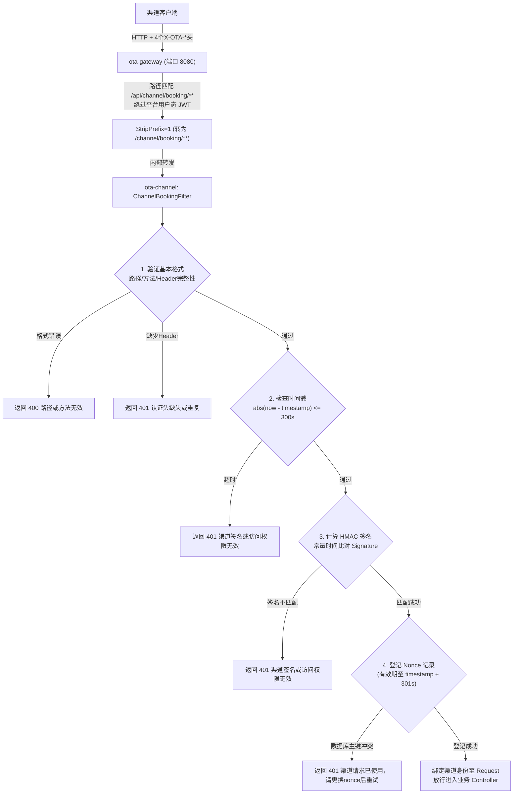

# OTA 渠道 API HMAC 签名鉴权接入指南

## 1. 概述与鉴权模型

OTA 平台开放给分销渠道（如飞猪、美团、携程等下游合作方）调用的 API（如报价查询、锁房试单、确认创单、取消退单等）采用 **HMAC-SHA256 签名摘要 + 时钟窗口 + Nonce 幂等防重放** 机制。

与 C 端用户使用的 OAuth2 / JWT 登录态不同，渠道对接属于典型的 **B2B Server-to-Server** 场景：
- **无状态直签**：无需维护 Access Token 生命周期，每一次 HTTP 请求均自带合法签名。
- **端到端防篡改**：签名涵盖 HTTP 方法、请求完整路径及 Query 参数、请求 Body 摘要，防止中间人篡改参数。
- **高安全防重放**：时间戳漂移严格控制在 `±300 秒` 内，且服务端记录并原子去重 Nonce。

---

## 2. 请求头规范

发起任何渠道 API 请求时，HTTP 请求头必须包含以下 4 个规范字段：

| 请求头 (Header Name) | 格式 / 规范 | 说明 |
| :--- | :--- | :--- |
| `X-OTA-Channel-Code` | `[A-Za-z0-9_-]{1,64}` | 平台分配给渠道的代码（例如：`MEITUAN_DIST`） |
| `X-OTA-Timestamp` | 10~12 位十进制整数 | 请求发起时的 UTC/Unix 秒级时间戳（与平台时钟偏差不超过 ±300 秒） |
| `X-OTA-Nonce` | `[A-Za-z0-9_-]{16,96}` | 客户端生成的随机唯一串，单渠道内全局唯一 |
| `X-OTA-Signature` | 64 位小写十六进制 | 基于渠道密钥由 `HmacSHA256` 计算得出的签名 |

> **注意**：
> - 所有请求头只允许出现一次，缺失或重复传递将直接返回 `401 渠道认证头缺失或重复`。
> - 请求体大小上限为 **256KB**（`262,144` 字节），超限返回 `413 渠道请求体过大`。

---

## 3. 待签名字符串（Canonical String）构建规范

### 3.1 待签名内容格式

客户端需将以下 6 项元素用换行符 `\n`（ASCII 10，LF）拼接为 UTF-8 字符串：

```text
{channelCode}\n{timestamp}\n{nonce}\n{method}\n{target}\n{bodySha256}
```

各字段拼接规则如下：

1. **channelCode**：与请求头 `X-OTA-Channel-Code` 完全一致。
2. **timestamp**：与请求头 `X-OTA-Timestamp` 完全一致的秒级字符串。
3. **nonce**：与请求头 `X-OTA-Nonce` 完全一致。
4. **method**：HTTP 请求方法全大写（目前仅开放 `GET` 与 `POST`）。
5. **target**：网关暴露的原始完整相对 URI，**必须包含 `/api` 前缀及完整 Query 参数**（形如 `/api/channel/booking/quotes?hotelId=1001`）。若无 Query 参数则直接为路径（如 `/api/channel/booking/orders`）。
6. **bodySha256**：对 HTTP Body 的原始字节数组（UTF-8）进行标准 SHA-256 哈希计算后转成 **64 位小写十六进制字符串**。
   - 若为 `GET` 请求或无请求体，Body 字节数组长度为 0（即 `new byte[0]`），其 SHA-256 结果固定为：
     `e3b0c44298fc1c149afbf4c8996fb92427ae41e4649b934ca495991b7852b855`。

### 3.2 计算签名

使用分配的渠道通讯密钥 `secret`（长度要求 $\ge 32$ 字节）：

$$
\text{Signature} = \text{HexEncode}(\text{HmacSHA256}(\text{Key} = \text{secret}, \text{Data} = \text{CanonicalString}))
$$

输出结果必须格式化为 **64 位小写十六进制字符串**。

---

## 4. Java 客户端完整代码示例

以下是基于 JDK 11+ 原生标准类库（无需依赖第三方库）编写的开箱即用客户端示例：

```java
package com.ota.cloud.channel.client;

import java.io.IOException;
import java.net.URI;
import java.net.http.HttpClient;
import java.net.http.HttpRequest;
import java.net.http.HttpResponse;
import java.nio.charset.StandardCharsets;
import java.security.MessageDigest;
import java.security.NoSuchAlgorithmException;
import java.time.Duration;
import java.time.Instant;
import java.util.HexFormat;
import java.util.UUID;
import javax.crypto.Mac;
import javax.crypto.spec.SecretKeySpec;

/**
 * OTA 渠道 API 标准调用客户端示例。
 * 纯 JDK 11+ 实现，无额外依赖。
 */
public class ChannelApiClient {

    private final String baseUrl;
    private final String channelCode;
    private final String secretKey;
    private final HttpClient httpClient;

    public ChannelApiClient(String baseUrl, String channelCode, String secretKey) {
        this.baseUrl = baseUrl.endsWith("/") ? baseUrl.substring(0, baseUrl.length() - 1) : baseUrl;
        this.channelCode = channelCode;
        this.secretKey = secretKey;
        this.httpClient = HttpClient.newBuilder()
                .connectTimeout(Duration.ofSeconds(5))
                .build();
    }

    /**
     * 发送 POST 请求（例如：报价询价、创建预订）
     *
     * @param targetPath 含 /api 前缀及 Query 参数的相对路径，例如：/api/channel/booking/orders
     * @param jsonBody   请求体 JSON 字符串
     * @return 接口响应 Body
     */
    public String post(String targetPath, String jsonBody) throws IOException, InterruptedException {
        byte[] bodyBytes = jsonBody != null ? jsonBody.getBytes(StandardCharsets.UTF_8) : new byte[0];
        return execute("POST", targetPath, bodyBytes, "application/json");
    }

    /**
     * 发送 GET 请求（例如：订单状态查询）
     *
     * @param targetPath 含 /api 前缀及 Query 参数的相对路径，例如：/api/channel/booking/orders/CH20261102001
     * @return 接口响应 Body
     */
    public String get(String targetPath) throws IOException, InterruptedException {
        return execute("GET", targetPath, new byte[0], null);
    }

    /**
     * 执行 HTTP 调用并注入 HMAC 签名头
     */
    private String execute(String method, String targetPath, byte[] bodyBytes, String contentType)
            throws IOException, InterruptedException {
        // 1. 生成鉴权元数据
        String timestamp = String.valueOf(Instant.now().getEpochSecond());
        String nonce = UUID.randomUUID().toString().replace("-", "") + UUID.randomUUID().toString().replace("-", "").substring(0, 8); // 40位随机串
        
        // 2. 计算 Body SHA-256
        String bodySha256 = sha256Hex(bodyBytes);

        // 3. 构造 Canonical String（换行符分隔）
        String canonicalString = channelCode + "\n"
                + timestamp + "\n"
                + nonce + "\n"
                + method + "\n"
                + targetPath + "\n"
                + bodySha256;

        // 4. 计算 HmacSHA256 签名（小写 Hex）
        String signature = hmacSha256Hex(secretKey, canonicalString);

        // 5. 组装 HTTP 请求
        URI fullUri = URI.create(baseUrl + targetPath);
        HttpRequest.Builder builder = HttpRequest.newBuilder()
                .uri(fullUri)
                .timeout(Duration.ofSeconds(10))
                .header("X-OTA-Channel-Code", channelCode)
                .header("X-OTA-Timestamp", timestamp)
                .header("X-OTA-Nonce", nonce)
                .header("X-OTA-Signature", signature);

        if (contentType != null) {
            builder.header("Content-Type", contentType);
        }

        if ("POST".equalsIgnoreCase(method)) {
            builder.POST(HttpRequest.BodyPublishers.ofByteArray(bodyBytes));
        } else {
            builder.GET();
        }

        // 6. 发送请求并获取结果
        HttpResponse<String> response = httpClient.send(builder.build(), HttpResponse.BodyHandlers.ofString(StandardCharsets.UTF_8));
        return response.body();
    }

    /**
     * SHA-256 计算摘要并转为小写十六进制
     */
    public static String sha256Hex(byte[] data) {
        try {
            MessageDigest digest = MessageDigest.getInstance("SHA-256");
            byte[] hash = digest.digest(data != null ? data : new byte[0]);
            return HexFormat.of().formatHex(hash);
        } catch (NoSuchAlgorithmException e) {
            throw new IllegalStateException("不支持 SHA-256 算法", e);
        }
    }

    /**
     * HmacSHA256 签名并转为小写十六进制
     */
    public static String hmacSha256Hex(String secret, String data) {
        try {
            Mac mac = Mac.getInstance("HmacSHA256");
            mac.init(new SecretKeySpec(secret.getBytes(StandardCharsets.UTF_8), "HmacSHA256"));
            byte[] rawHmac = mac.doFinal(data.getBytes(StandardCharsets.UTF_8));
            return HexFormat.of().formatHex(rawHmac);
        } catch (Exception e) {
            throw new IllegalStateException("HmacSHA256 计算签名失败", e);
        }
    }

    // ================= 测试运行示例 =================
    public static void main(String[] args) {
        try {
            // 参数配置（线下联调环境）
            String gatewayUrl = "http://localhost:8080";
            String channelCode = "CTRIP_CHANNEL";
            String channelSecret = "ctrip_secure_secret_key_1234567890_min32chars";

            ChannelApiClient client = new ChannelApiClient(gatewayUrl, channelCode, channelSecret);

            // 示例 1: POST 锁房预订
            String bookingPayload = """
                    {
                      "channelOrderNo": "CTRIP_ORD_987654321",
                      "hotelId": 1001,
                      "roomId": 2001,
                      "checkIn": "2026-12-01",
                      "checkOut": "2026-12-02",
                      "guestName": "张三",
                      "contactPhone": "13800000000"
                    }
                    """;
            System.out.println(">>> 发起 POST 预订请求...");
            String bookingResponse = client.post("/api/channel/booking/orders", bookingPayload);
            System.out.println("<<< 预订响应:\n" + bookingResponse);

            // 示例 2: GET 查询订单
            System.out.println("\n>>> 发起 GET 订单查询...");
            String queryResponse = client.get("/api/channel/booking/orders/CTRIP_ORD_987654321");
            System.out.println("<<< 查询响应:\n" + queryResponse);

        } catch (Exception e) {
            e.printStackTrace();
        }
    }
}
```

---

## 5. 服务端验签流程说明

在 OTA 架构中，网关及渠道服务的鉴权逻辑如下：



---

## 6. 常见排查与错误码说明

| HTTP 状态码 | 业务错误信息 | 常见触发原因与排障建议 |
| :--- | :--- | :--- |
| `400` | 渠道请求路径或方法无效 | 路径不符合规范或包含非法字符，或使用了非 `GET`/`POST` 的 HTTP 方法。 |
| `401` | 渠道认证头缺失或重复 | 检查请求是否缺少 `X-OTA-Channel-Code`、`X-OTA-Timestamp`、`X-OTA-Nonce`、`X-OTA-Signature`，或同一 Header 在 Header 中出现多次。 |
| `401` | 渠道签名或访问权限无效 | 1. **时钟偏差**：检查客户端机器与标准 NTP 时间是否偏差超过 5 分钟；<br/>2. **target 参数不对**：确保计算签名时的 `target` 包含 `/api` 前缀及完整 Query String（例如 `/api/channel/booking/quotes?hotelId=1001`）；<br/>3. **Body 编码或格式被改**：检查发送字节流与计算 SHA256 时的字节是否完全一致；<br/>4. **Secret 不一致**：确认双方配置的密钥是否匹配。 |
| `401` | 渠道请求已使用，请更换nonce后按业务幂等重试 | 当前 `nonce` 在该渠道下 5 分钟内已被消费过，防止重放攻击。网络重试时必须重新生成 `nonce` 和 `timestamp` 并重新计算签名。 |
| `413` | 渠道请求体过大 | 请求 Body 超过 256KB（262,144 字节）。 |
| `503` | 渠道认证存储暂不可用 | 服务端持久化 Nonce 存储出现故障，平台执行安全失败关闭（Fail-Closed）。 |

