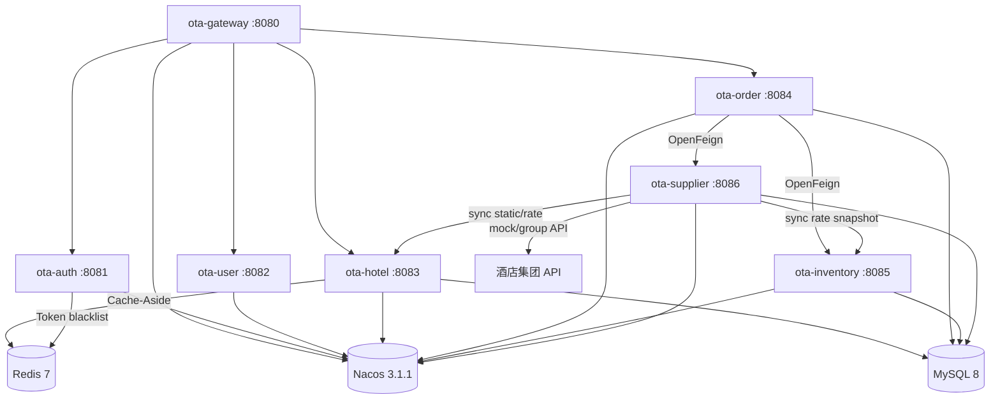

# otaapi Monorepo 架构演进：OTA 酒店云平台面试展示版实施计划

> 对齐依据：[ota-cloud-需求文档.md](./ota-cloud-需求文档.md) v1.2  
> 稳定技术线：JDK 21 + Spring Boot 3.5.14 + Spring Cloud 2025.0.x + Spring Cloud Alibaba 2025.0.x  
> 升级备选：Spring Boot 4.x + Spring Cloud 2025.1.x + Spring Cloud Alibaba 2025.1.0.0

本计划用于把现有 `otaapi` 大体量渠道系统的业务经验，沉淀为一套可运行、可演示、可讲清楚的 `ota-cloud` 微服务面试展示项目。第一目标不是一次性复刻生产级 OTA 平台，而是在约 13 天内完成“核心链路可跑通、架构亮点可展示、取舍逻辑可解释”的 Demo。

核心演示链路：

```text
酒店集团 API 同步静态/价库 → 标准化酒店/价库模型 → 用户查询
→ 创建平台订单 → 集团试单/验价 → 集团下单 → 支付/取消/状态同步 → Kafka 事件通知
```

---

## 一、架构演进口径

### 1.1 老系统背景

现有 `otaapi` 是拥有 15+ 渠道对接、57 个 Maven 模块的聚合大单体 Monorepo，覆盖华住、锦江、东呈、高德等酒店分销场景。它可以作为面试叙事里的真实业务底座：渠道协议复杂、历史包袱重、数据模型厚，但也存在演进压力。

### 1.2 演进痛点

| 痛点 | 演进目标 |
|------|----------|
| 大单体模块耦合重 | 按认证、标准酒店、标准价库、订单编排、供应适配、渠道适配拆分服务边界 |
| JDK 8 阻塞 IO 成本高 | 使用 JDK 21 虚拟线程验证阻塞式 IO 服务收益 |
| 集团 API 协议差异大 | 使用 `ota-supplier` 统一供应侧端口，屏蔽华住、东呈、雅斯特、华驿、锦江差异 |
| 酒店详情和价库查询压力大 | 集团 API 同步后本地标准化缓存，使用 Redis Cache-Aside、空值缓存、热点保护 |
| 订单履约链路复杂 | P0 用平台订单 + 集团订单号 + 状态机 + 补偿，P1 用 Seata AT 演示本地库一致性 |
| 自有分销和平台渠道报文不同 | `ota-distribution-api` 对应 `hoa-*`，`ota-channel-adapter` 对应高德/百度 |
| 异步通知缺少可靠链路 | Kafka + Outbox + 重试/死信 |
| 排障依赖单机日志 | TraceId、Zipkin、Prometheus/Grafana、ELK 分阶段引入 |

### 1.3 新系统定位

`ota-cloud` 是从老系统中抽取业务模型和面试素材后，全新建设的现代微服务展示系统。P0 保证主链路可运行；P1 增强可靠性和治理能力；P2 补充 AI、分库分表、监控、日志和原生镜像等亮点。

---

## 二、现有项目复用映射

| 新模块 | 职责 | 可参考的老系统资产 | 实施策略 |
|--------|------|------------------|----------|
| `ota-common` | 公共 DTO、异常、响应、工具类 | `cloud-common-components/java-base`、`common-web`、`common-redis` | 只吸收成熟模型和工具思想，按 Boot 3.5 重新整理，避免把旧依赖直接拖入新项目 |
| `ota-gateway` | 统一入口、路由、鉴权、TraceId、限流 | `common-web`、网关/拦截器经验 | 使用 Spring Cloud Gateway；JWT 本地校验，必要时调用 `ota-auth /auth/validate` |
| `ota-auth` | 登录、JWT、刷新、黑名单、权限上下文 | 老系统登录、Redis 工具经验 | Spring Security 6 + BCrypt + Redis 黑名单，提供内部 Token 校验接口 |
| `ota-user` | 注册、用户资料、权限基础信息 | 老系统用户基础表和 DTO 思路 | 独立用户服务，支撑认证与面试演示 |
| `ota-hotel` | 标准酒店、房型、城市、集团映射、详情缓存 | `hoa-main-db`、`hoa-api`、`hoa-normal`、`HotelOrderTask` 静态同步模型 | 保存平台 hotelId 与 supplierCode/supplierHotelId 映射，重点展示标准模型和热点缓存治理 |
| `ota-inventory` | 标准房价库存、价库快照、本地短时预占 | `hoa-roomprice-redis`、`HotelOrderTask` 价库同步模型 | 价库来自集团 API，同步为本地标准快照；本地 hold 只防重复提交，不作为最终库存依据 |
| `ota-supplier` | 集团供应侧适配：静态、价库、试单、下单、取消、查询 | `huazhu`、`dongcheng`、`yeste`、`hyrj`、`jinjiang`、`HotelOderService1` | 抽象 `HotelContentPort`、`RateInventoryPort`、`BookingPort`，P0 mock/华住风格，P1 多集团 |
| `ota-order` | 平台订单、集团订单编排、支付、取消、状态机、Outbox | `HotelOderService1` 订单交易服务 | 平台订单先落库，再调用供应侧试单/下单，保存 supplierOrderNo/channelOrderNo |
| `ota-distribution-api` | 自有标准分销 API | `hoa-*` | 对外提供标准酒店、价库、下单、取消、查询接口 |
| `ota-channel-adapter` | 平台分销渠道适配 | `gaode`、`baidu` | 转换高德/百度查价、下单、取消、回调报文到 ota-cloud 标准模型 |
| `ota-ai` | 推荐、问答、评论摘要 | 酒店 FAQ、周边攻略、订单规则 | P2 独立服务，未配置模型 API Key 时不影响 P0 主链路 |

---

## 三、阶段实施计划

### 3.1 P0：核心交易闭环，约 7 天

目标：只依赖 Nacos、MySQL、Redis，使用 mock/华住风格供应适配器跑通登录、集团静态/价库同步、酒店查询、价库查询、集团试单/下单、支付、取消。



| 任务 | 交付内容 | 验收标准 |
|------|----------|----------|
| P0-1 父 POM 与骨架 | `ota-cloud` 聚合模块、BOM、JDK 21、虚拟线程配置、`ota-common` | `mvn clean compile -DskipTests` 能通过，新服务不影响旧模块 |
| P0-2 认证/用户/网关 | `ota-gateway`、`ota-auth`、`ota-user`，JWT、黑名单、白名单、用户上下文透传 | 登录后通过 Gateway 访问受保护接口；无 Token 返回统一 401 |
| P0-3 酒店/价库/供应同步 | `ota-supplier` mock/华住风格同步静态和价库；`ota-hotel`、`ota-inventory` 标准查询 | 可同步酒店/房型/价库并通过 Gateway 查询标准酒店和标准价库 |
| P0-4 订单服务 | `/order/create`、`/order/pay`、`/order/cancel`、`/order/{id}`、`/order/list`；调用 supplier prebook/book/cancel | 订单 INIT → PRECHECKED → SUPPLIER_BOOKING → WAIT_PAY/PAID/CANCELLED/CLOSED 流转正确 |
| P0-5 供应补偿 | supplierOrderNo 保存、集团订单查询、取消补偿、本地 hold 释放 | 集团下单成功但本地异常可通过 supplierOrderNo 修复 |
| P0-6 补偿与演示脚本 | 超时释放、异常补偿、初始化 SQL、curl/Postman 脚本 | 一键或顺序脚本能演示完整主链路 |

P0 一致性口径：不把 Kafka 或 Seata 描述为核心事务依赖。集团订单是最终履约凭证，本地库存预占只用于防重复提交；订单与供应侧通过平台订单号、supplierOrderNo、状态机、幂等接口、补偿任务收敛一致性。

### 3.2 P1：微服务治理与可靠性，约 3 天

目标：增强面试展示深度，引入 Kafka、Zipkin、Sentinel、OpenAPI、Seata AT。

| 任务 | 交付内容 | 验收标准 |
|------|----------|----------|
| P1-1 多集团供应适配 + Kafka Outbox | 扩展 `huazhu`、`dongcheng`、`yeste`、`hyrj`、`jinjiang` 适配模板；`supplier-booked`、`order-paid`、`order-cancelled`、`inventory-changed` | 可切换 supplierCode 路由不同集团适配器；订单事件发送失败可重试、消费失败可进死信 |
| P1-2 自有分销 API + 平台渠道适配 + 可观测性 | `ota-distribution-api` 对应 `hoa-*`；`ota-channel-adapter` 对应 `gaode/baidu`；Zipkin、Sentinel、OpenAPI | 可演示自有分销查价/下单，以及高德/百度请求转换为标准模型；能按 TraceId 查看 Gateway/Channel/Order/Supplier 链路 |
| P1-3 Seata AT 演示 | 独立演示服务或演示入口，订单库 + 本地价库/hold 流水异常回滚 | 可模拟本地订单/hold 异常回滚，并说明外部集团 API 只能走补偿；不侵入 P0 主路径 |

### 3.3 P2：技术亮点扩展，约 3 天

目标：根据面试方向补充可展示的前沿能力，但不阻塞 P0/P1。

| 任务 | 交付内容 | 验收标准 |
|------|----------|----------|
| P2-1 AI 推荐/问答 | `ota-ai`、`/ai/recommend`、`/ai/assistant`、`/ai/summary`，Spring AI + DeepSeek API | 未配置 API Key 时主链路不受影响；配置后可演示推荐/问答 |
| P2-2 ShardingSphere | 订单按 order_id 分表、库存按 hotel_id 分表、酒店按 city_id 分库方案 | 能说明分片键、非分片键查询、分页排序和扩容迁移取舍 |
| P2-3 监控日志与 CI | Prometheus/Grafana、ELK、GitHub Actions | 能按指标、链路、日志三维定位一次订单问题 |
| P2-4 GraalVM 验证 | 单服务 Native Image 构建和对比报告 | 输出启动耗时、镜像体积、限制说明 |

---

## 四、关键设计口径

### 4.1 服务边界

P0 服务数固定为 7 个业务服务 + `ota-common`：Gateway、Auth、User、Hotel、Inventory、Order、Supplier。`ota-ai` 是 P2 独立业务服务。P1 增加自有分销 API 和平台渠道适配。

| 边界 | 阶段 | 职责 |
|------|------|------|
| `ota-supplier` | P0/P1 | 对接酒店集团供应 API，统一静态、价库、试单、下单、取消、查询 |
| `ota-hotel` | P0 | 标准酒店、房型、城市、供应商映射、详情缓存 |
| `ota-inventory` | P0 | 标准价库快照、可售缓存、本地短时 hold |
| `ota-order` | P0 | 平台订单、集团订单编排、支付、取消、补偿 |
| `ota-distribution-api` | P1 | 自有标准分销 API，对应 `hoa-*` |
| `ota-channel-adapter` | P1 | 平台渠道适配，对应 `gaode`、`baidu` |

### 4.2 供应适配边界

`ota-supplier` 内部建议用端口适配器组织：

| 端口/包 | 阶段 | 职责 |
|---------|------|------|
| `port.HotelContentPort` | P0/P1 | 酒店列表、详情、房型、设施、图片、城市、品牌 |
| `port.RateInventoryPort` | P0/P1 | 房价、库存、销售限制、取消规则、早餐政策 |
| `port.BookingPort` | P0/P1 | 试单/验价、创建集团订单、取消集团订单、查询集团订单 |
| `adapter.mock` | P0 | mock/华住风格供应适配器，保证无真实账号也能演示 |
| `adapter.huazhu/dongcheng/yeste/hyrj/jinjiang` | P1 | 多集团 API 适配模板 |

P1 验收重点是“能讲清三类系统边界并跑通模拟链路”，不是一次性对接真实渠道账号。真实渠道鉴权、签名、重试策略可以作为 P2 或生产化扩展。

### 4.3 接口口径

| 服务 | P0 核心接口 |
|------|-------------|
| Auth/User | `/auth/login`、`/auth/logout`、`/auth/validate`、`/auth/refresh`、`/user/register`、`/user/info`、`/user/update` |
| Hotel | `/hotel/list`、`/hotel/{id}`、`/hotel/search`、`/hotel/room/list`、`/hotel/nearby` |
| Inventory | `/inventory/price/query`、`/inventory/snapshot/update`、`/inventory/precheck`、`/inventory/hold`、`/inventory/release`、`/inventory/record/{orderId}` |
| Order | `/order/create`、`/order/{id}`、`/order/cancel`、`/order/pay`、`/order/list` |
| Supplier | `/supplier/hotel/sync`、`/supplier/rate/sync`、`/supplier/prebook`、`/supplier/book`、`/supplier/cancel`、`/supplier/order/query` |
| Distribution(P1) | `/distribution/hotel/search`、`/distribution/inventory/query`、`/distribution/order/create`、`/distribution/order/cancel` |
| Channel(P1) | `/channel/gaode/**`、`/channel/baidu/**` |
| AI(P2) | `/ai/recommend`、`/ai/assistant`、`/ai/summary` |

### 4.4 数据一致性

| 场景 | 处理方式 |
|------|----------|
| 本地价库预校验失败 | 订单转 CLOSED，返回库存不足或价库过期 |
| 集团试单/验价失败 | 释放本地 hold，订单 CLOSED，记录 supplier error |
| 集团下单成功但本地更新失败 | 通过 supplierOrderNo 查询集团订单并修复本地状态 |
| 支付成功但渠道通知失败 | 订单保持 PAID，outbox 重试通知 |
| 取消集团订单失败 | 写供应侧取消补偿任务，后台重试 |
| Kafka 发送失败 | Outbox 表保留 PENDING，定时任务重发，超阈值进入告警/死信 |

### 4.5 缓存策略

| 数据 | Key | 策略 |
|------|-----|------|
| 酒店详情 | `hotel:detail:{hotelId}` | Cache-Aside + 空值缓存，30 分钟 + 随机抖动 |
| 酒店列表 | `hotel:list:{city}:{page}:{hash}` | Cache-Aside，5 分钟 + 随机抖动 |
| 价库单日 | `ps:{supplierCode}:{supplierHotelId}:{roomType}:{date}` | Cache-Aside + 精确删除，5 分钟 |
| 价库版本 | `ps:version:{supplierCode}:{supplierHotelId}` | 更新时递增版本 |
| 供应订单 | `supplier:order:{supplierCode}:{supplierOrderNo}` | 集团订单查询结果短缓存 |
| Token 黑名单 | `jwt:blacklist:{jti}` | 登出写入，TTL 等于 JWT 剩余有效期 |

不把 `ps:{hotelId}:*` 通配删除作为主方案；房价库存变更时优先精确删除受影响日期 key，批量场景使用版本号 key 或维护索引集合。

---

## 五、验收与交付标准

### 5.1 编译验证

在 `otaapi` 根目录执行：

```bash
mvn clean compile -DskipTests
```

要求旧模块和新增 `ota-cloud` 模块都能通过编译，新模块依赖不污染旧模块。

### 5.2 P0 主链路验证

1. 启动 Nacos、MySQL、Redis。
2. 启动 `ota-auth`、`ota-user`、`ota-hotel`、`ota-inventory`、`ota-order`、`ota-gateway`。
3. 注册/登录，获取 JWT。
4. 通过 Gateway 查询酒店列表和酒店详情，验证 Redis 缓存命中。
5. 查询指定酒店、房型、日期范围的房价库存。
6. 创建订单，验证本地 hold、供应侧试单和集团下单，保存 supplierOrderNo。
7. 支付订单，验证平台订单状态变为 PAID，并写入 Outbox。
8. 取消未支付订单，验证调用供应侧取消并释放本地 hold。

### 5.3 P1/P2 展示验证

| 能力 | 验证方式 |
|------|----------|
| Kafka Outbox | 人为停止 Kafka 后支付订单，恢复 Kafka 后确认 Outbox 重发 |
| Zipkin | 通过 TraceId 查到 Gateway → Auth → Order → Inventory 链路 |
| Sentinel | 压测热点 hotelId，观察限流响应 |
| Seata AT | 演示订单库 + 本地价库/hold 流水异常回滚，说明外部集团 API 需补偿 |
| Prometheus/Grafana | 查看 JVM、接口延迟、Redis、Kafka 指标 |
| ELK | 使用 traceId/orderId 检索完整日志 |
| GraalVM | 输出单服务 JVM 与 Native Image 的启动耗时和镜像体积对比 |

---

## 六、面试叙事重点

1. 这是从真实 OTA 渠道大单体经验中抽取出来的现代微服务展示系统，不是空泛脚手架。
2. P0 只用 Nacos、MySQL、Redis 跑通核心交易闭环，展示务实落地能力。
3. 订单和供应履约不靠一句“分布式事务”糊过去，而是明确说明平台订单、集团订单号、状态机、幂等、流水和补偿。
4. Kafka 通过 Outbox 保证最终一致性；Seata AT 只作为 P1 强一致性演示，不混进 Kafka 事务范围。
5. 可观测性分层清楚：Zipkin 看链路，Prometheus/Grafana 看指标，ELK 查日志。
6. P2 的 AI、分库分表、GraalVM 都是增强项，不阻塞主链路。

---

> 执行时优先完成 P0 主链路，再按 P1/P2 增强技术展示深度。所有性能数字都以压测报告为准，不在文档中承诺没有验证依据的绝对指标。
