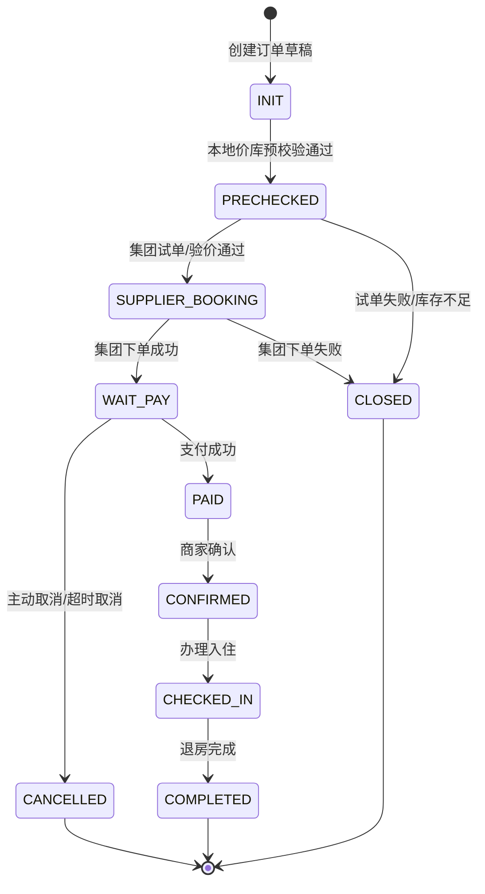

# OTA 酒店云平台 — 面试展示版技术需求文档

> 版本：v1.2 | 日期：2026-05-27  
> 稳定技术线：Spring Boot 3.5.14 + Spring Cloud 2025.0.x + Spring Cloud Alibaba 2025.0.x  
> 升级备选：Spring Boot 4.x + Spring Cloud 2025.1.x + Spring Cloud Alibaba 2025.1.0.0

---

## 一、项目概述

### 1.1 项目定位

基于 19 年 Java 开发经验和 8 年 OTA 酒店分销经验，构建一套面向酒店行业的微服务云平台 Demo。项目优先服务于求职面试、接单背书和技术验证，目标不是一次性复刻生产级 OTA 平台，而是做出一条可运行、可演示、可解释的业务闭环。

第一版聚焦“面试展示版 MVP”。与普通酒店库存 Demo 不同，本项目的真实业务主线是“多酒店集团供应接入 + 自有分销 API + 平台渠道分销”：

```text
酒店集团 API 同步静态/价库 → 标准化酒店/价库模型 → 用户查询
→ 创建平台订单 → 集团试单/验价 → 集团下单 → 支付/取消/状态同步 → Kafka 事件通知
```

面试展示时围绕这条链路说明供应适配、标准模型、微服务拆分、缓存、订单编排、消息补偿、链路追踪和限流降级。

老系统对应关系：
- `huazhu`、`dongcheng`、`yeste`、`hyrj`、`jinjiang`：酒店集团供应侧适配，负责集团静态、价库库存、试单/验价、下单、取消和订单查询。
- `hoa-*`：自有酒店分销 API，对外提供标准化酒店、价库和订单能力。
- `gaode`、`baidu`：平台分销渠道适配，把高德/百度报文转换为平台标准模型，再编排供应侧能力。

### 1.2 核心能力

| 能力 | P0 交付 | 面试展示点 |
|------|---------|------------|
| 统一入口 | Gateway 路由、JWT 鉴权、基础限流 | 为什么网关适合做统一鉴权和流量入口 |
| 用户认证 | 注册、登录、JWT、用户信息 | Spring Security 6 + BCrypt + Token 黑名单 |
| 供应接入 | 集团静态/房型/价库同步，集团试单/下单/取消 | 多集团 API 适配、字段标准化、幂等同步 |
| 酒店查询 | 标准酒店列表、详情、房型查询 | 集团静态数据缓存、缓存击穿/穿透防护 |
| 价库库存 | 标准房价库存查询、价库快照、可售状态 | 集团价库拉取、标准价库合一、缓存失效 |
| 订单链路 | 平台订单创建、集团下单、支付、取消、订单列表 | 平台订单号 + 集团订单号 + 渠道订单号映射，订单状态机和补偿 |
| 分销输出 | 自有分销 API、平台渠道适配 | `hoa-*` 标准 API、高德/百度渠道报文转换 |
| 事件通知 | Kafka 订单/库存事件 | 最终一致性、失败重试、死信队列 |
| 可观测性 | Actuator、TraceId、Zipkin、Prometheus/Grafana、ELK | 一次请求跨服务定位问题，结合链路、指标和日志排障 |

### 1.3 范围分层

| 阶段 | 定位 | 内容 |
|------|------|------|
| P0 | 可运行核心链路 | Gateway、Auth/User、Hotel、Inventory、Order、Supplier Adapter(mock/华住风格)、Redis、MySQL、Nacos |
| P1 | 面试增强链路 | 多集团供应适配、`hoa-*` 自有分销 API、gaode/baidu 渠道适配、Kafka 事件、Zipkin、Sentinel、OpenAPI、Seata AT 演示 |
| P2 | 技术亮点扩展 | AI 推荐、ShardingSphere、Prometheus/Grafana、ELK、GitHub Actions、GraalVM Native Image |

---

## 二、技术栈

### 2.1 基础框架

| 组件                   | 版本       | 用途                      | 说明                             |
| -------------------- | -------- | ----------------------- | ------------------------------ |
| JDK                  | 21 LTS   | 运行时                     | 支持虚拟线程，作为 Boot 3.5 稳定选择        |
| Spring Boot          | 3.5.14   | 应用框架                    | 当前稳定主线                         |
| Spring Cloud         | 2025.0.x | 微服务治理                   | 与 Boot 3.5 匹配                  |
| Spring Cloud Alibaba | 2025.0.x | Nacos/Sentinel/Seata 集成 | 与 Boot 3.5 + Cloud 2025.0.x 匹配 |
| Maven                | 3.9+     | 项目构建                    | 多模块父 POM 管理                    |

> 说明：Spring Cloud Alibaba 2025.1.0.0 更适合作为 Spring Boot 4.x + Spring Cloud 2025.1.x 的升级备选，不放入 P0 稳定技术线，避免依赖矩阵冲突。

### 2.2 中间件

| 组件 | 版本 | 阶段 | 用途 |
|------|------|------|------|
| Nacos | 3.1.1 | P0 | 注册中心 + 配置中心 |
| MySQL | 8.0+ | P0 | 业务数据存储 |
| Redis | 7.x | P0 | 缓存、Token 黑名单、分布式锁 |
| Kafka | 3.9.x | P1 | 订单/库存事件、异步通知、失败重试 |
| Sentinel | 1.8.10 | P1 | 网关限流、热点酒店查询保护 |
| Seata | 2.6.0 | P1 | 订单库和库存库一致性演示 |
| Zipkin | 3.x | P1 | 链路追踪展示 |
| ShardingSphere | 5.x | P2 | 分库分表和分布式 ID 展示 |
| Prometheus/Grafana | 3.x/11.x | P2 | 指标采集和可视化面板 |
| ELK | 8.x | P2 | 应用日志采集、检索、分析 |

### 2.3 业务框架

| 组件                            | 阶段    | 用途            |
| ----------------------------- | ----- | ------------- |
| Spring Cloud Gateway          | P0    | API 网关        |
| OpenFeign                     | P0    | 服务间调用         |
| Spring Cloud LoadBalancer     | P0    | 客户端负载均衡       |
| MyBatis-Plus 3.5.16           | P0    | ORM           |
| Spring Security 6.x           | P0    | 认证授权          |
| Feign/WebClient/Retrofit 适配思想 | P0/P1 | 酒店集团 API 调用适配 |
| Spring Doc OpenAPI 3          | P1    | 接口文档聚合        |
| Micrometer Tracing            | P1    | TraceId 透传    |
| Spring AI 1.1.7               | P2    | 酒店推荐/问答       |

### 2.4 亮点技术口径

| 技术点 | 演示口径 | 验证方式 |
|--------|----------|----------|
| 虚拟线程 | 提升 IO 密集型接口并发能力 | 用 JMeter/Gatling 对比平台线程和虚拟线程吞吐、P99 |
| Redis 缓存 | 热点酒店详情和价库查询加速 | Actuator 指标 + 日志观察命中率 |
| 供应适配器 | 屏蔽华住、东呈、雅斯特、华驿、锦江 API 差异 | 用统一 `SupplierPort` 演示静态、价库、试单、下单、取消 |
| Kafka 事件 | 订单成功后异步通知渠道/用户 | 人为制造消费失败，观察重试和死信 |
| Seata AT | 订单和库存跨库一致性演示 | 模拟库存服务异常，验证回滚或补偿 |
| Sentinel | 热点酒店限流和熔断降级 | 压测指定 hotelId 观察限流响应 |
| Zipkin | 跨 Gateway/Hotel/Inventory/Order 链路定位 | 通过 TraceId 追踪一次下单请求 |
| ELK | 集中检索 Gateway/Auth/Hotel/Inventory/Order 日志 | 通过 traceId/orderId 查询一次下单链路的完整日志 |
| ShardingSphere | 数据规模扩展方案 | P2 使用订单表取模分表演示 |
| GraalVM | 原生镜像启动优化探索 | P2 单服务验证启动耗时和镜像体积 |

---

## 三、系统架构

### 3.1 逻辑架构图

```text
┌─────────────────────────────────────────────────────────────┐
│                       Web / App / Postman                    │
└──────────────────────────────┬──────────────────────────────┘
                               │
┌──────────────────────────────▼──────────────────────────────┐
│                     ota-gateway :8080                        │
│              路由 / 白名单 / 限流 / TraceId                  │
└──────────────────────────────┬──────────────────────────────┘
                               │
┌──────────────────────────────▼──────────────────────────────┐
│                      ota-auth :8081                          │
│        登录 / 签发 JWT / Token 校验 / 权限解析 / 黑名单       │
└──────────────────────────────┬──────────────────────────────┘
                               │
┌──────────────┬──────────────┬──────────────┬──────────────┬──────────────┐
│ ota-user     │ ota-hotel    │ ota-order    │ ota-inventory│ ota-supplier │
│ :8082        │ :8083        │ :8084        │ :8085        │ :8086        │
│ 用户资料/注册 │ 标准酒店/缓存 │ 平台订单编排 │ 标准价库/快照 │ 集团API适配  │
└──────┬───────┴──────┬───────┴──────┬───────┴──────┬───────┴──────┬───────┘
       │              │              │              │              │
┌──────▼──────────────▼──────────────▼──────────────▼──────────────▼──────┐
│              ota-distribution-api(P1) / ota-channel-adapter(P1)          │
│              自有分销 API(hoa-*) / 平台渠道适配(gaode, baidu)             │
└──────────────────────────────────┬───────────────────────────────────────┘
                                   │
┌──────────────────────────────────▼───────────────────────────────────────┐
│                    酒店集团供应 API                                      │
│        huazhu │ dongcheng │ yeste │ hyrj │ jinjiang                      │
└──────────────────────────────────┬───────────────────────────────────────┘
                                   │
┌──────▼──────────────▼──────────────▼──────────────▼──────────────▼──────┐
│                              基础设施层                                  │
│ Nacos │ MySQL │ Redis │ Kafka(P1) │ Zipkin(P1) │ Seata(P1)             │
│ Prometheus/Grafana(P2) │ ELK(P2) │ ShardingSphere JDBC(P2)                │
└──────────────────────────────────────────────────────────────────────────┘
```

> 说明：图中的 `ota-auth` 表示认证中心能力参与网关鉴权。实现上采用 Gateway 认证过滤器读取 JWT，必要时调用 `ota-auth` 校验/解析 Token；不是让所有业务流量物理转发到 auth 后再二次转发。`ota-supplier` 是供应侧适配边界，P0 可以用 mock/华住风格适配器跑通，P1 再扩展多集团。`ota-distribution-api` 对应自有 `hoa-*` 分销 API，`ota-channel-adapter` 对应高德/百度平台分销。

### 3.2 模块职责

| 模块              | 端口   | 阶段  | 说明                                  |
| --------------- | ---- | --- | ----------------------------------- |
| `ota-gateway`   | 8080 | P0  | API 网关，统一入口、白名单、认证过滤器、路由、限流、TraceId |
| `ota-auth`      | 8081 | P0  | 认证中心，登录、签发/校验/刷新 JWT、Token 黑名单、权限解析 |
| `ota-user`      | 8082 | P0  | 用户资料、注册、权限基础信息                      |
| `ota-hotel`     | 8083 | P0  | 酒店、房型、城市、酒店详情缓存                     |
| `ota-order`     | 8084 | P0  | 平台订单创建、集团下单编排、支付、取消、订单状态机          |
| `ota-inventory` | 8085 | P0  | 标准房价库存查询、集团价库快照、可售状态缓存              |
| `ota-supplier`  | 8086 | P0/P1 | 酒店集团 API 适配，静态/价库同步、试单、下单、取消、查询     |
| `ota-distribution-api` | 8088 | P1 | 自有标准分销 API，对应 `hoa-*` 对外能力             |
| `ota-channel-adapter` | 8089 | P1 | 平台渠道适配，对应高德、百度等分销渠道报文转换             |
| `ota-ai`        | 8087 | P2  | Spring AI 推荐、问答、评论摘要                |
| `ota-common`    | —    | P0  | 公共 DTO、异常、响应结构、工具类                  |

### 3.3 供应、标准模型与分销边界

P0 不把供应侧、标准领域服务和分销侧混在一个“库存服务”里。主边界如下：

| 边界 | 对应老系统 | 职责 | 阶段 |
|------|------------|------|------|
| `ota-supplier` | `huazhu`、`dongcheng`、`yeste`、`hyrj`、`jinjiang` | 对接酒店集团 API，拉取静态/房型/价库库存，执行试单/验价、下单、取消、订单查询 | P0/P1 |
| `ota-hotel` | `hoa-main` 酒店模型、集团静态同步结果 | 保存标准酒店、品牌、城市、房型、图片、设施和集团映射关系 | P0 |
| `ota-inventory` | `hoa-roomprice-redis`、集团价库同步结果 | 保存标准价库快照、可售状态、价格日历、取消规则和缓存 | P0 |
| `ota-order` | `HotelOderService1` 订单编排逻辑 | 保存平台订单、集团订单号、渠道订单号，编排供应侧下单/取消/查询 | P0 |
| `ota-distribution-api` | `hoa-*` | 对外提供自有标准分销 API，屏蔽不同集团 API 差异 | P1 |
| `ota-channel-adapter` | `gaode`、`baidu` | 对接平台分销渠道，处理查价、下单、取消、状态同步等渠道报文 | P1 |

`ota-supplier` 内部端口建议按能力拆分：

| 端口 | 职责 | 老系统参考 |
|------|------|------------|
| `HotelContentPort` | 酒店列表、酒店详情、房型、设施、图片、品牌、城市 | `HotelOrderTask` 中华住 `hotels/hotel/ari/products`，华驿/雅斯特静态接口 |
| `RateInventoryPort` | 房价、库存、销售限制、取消规则、早餐政策、价库变更 | 华住 `ari/daily/offers`、`ari/daily/inventory`，雅斯特房价房量接口，`hoa-roomprice-redis` |
| `BookingPort` | 试单/验价、创建集团订单、取消集团订单、查询集团订单 | 华住 `reservation/prebook/book/cancel/detail`，华驿 `CheckAvailable/CreateOrder/CancelOrder`，雅斯特 `Book/CancelPersonBook` |

P0 可以只实现 `mock-group` 或“华住风格”的供应适配器，跑通标准链路；P1 再扩展 `huazhu`、`dongcheng`、`yeste`、`hyrj`、`jinjiang` 多集团适配。

### 3.4 物理部署图

```text
┌──────────────────── Windows / macOS / Linux 开发机 ───────────────────┐
│                                                                       │
│  业务服务同层部署                                                      │
│  ┌────────────┬───────────┬───────────┬───────────┐                  │
│  │ Gateway    │ Auth      │ User      │ Hotel     │                  │
│  │ :8080      │ :8081     │ :8082     │ :8083     │                  │
│  └────────────┴───────────┴───────────┴───────────┘                  │
│  ┌────────────┬───────────────┬───────────────────┐                  │
│  │ Order      │ Inventory     │ Supplier     │ AI (P2)             │
│  │ :8084      │ :8085         │ :8086        │ :8087               │
│  └────────────┴───────────────┴──────────────┴───────────────────────┘
│  │ Distribution API(P1) :8088 │ Channel Adapter(P1) :8089             │
│                                                                       │
│  Docker Compose 基础设施                                               │
│  ┌───────────────────────────────────────────────────────────────┐    │
│  │ Nacos:8848 │ MySQL:3306 │ Redis:6379 │ Kafka:9092(P1)         │    │
│  │ Zipkin:9411(P1) │ Seata(P1) │ Prometheus:9090(P2) │ Grafana:3000 │  │
│  │ ELK(P2)                                                        │  │
│  └───────────────────────────────────────────────────────────────┘    │
│                                                                       │
│  AI 是 P2 独立业务服务，与 user/hotel/order/inventory 并列；            │
│  未配置大模型 API Key 时不阻塞 P0 主链路。                              │
└───────────────────────────────────────────────────────────────────────┘
```

---

## 四、业务功能

### 4.1 网关服务 (ota-gateway)

| 功能 | 说明 |
|------|------|
| 路由转发 | 按 `/api/auth/**`、`/api/user/**`、`/api/hotel/**`、`/api/inventory/**`、`/api/order/**`、`/api/ai/**` 分发 |
| 统一鉴权 | 白名单放行登录/注册/OpenAPI；其他请求由 Gateway 认证过滤器校验 JWT，必要时调用 `ota-auth` 解析 Token 后转发 |
| 限流 | P1 接入 Sentinel Gateway，对热点接口限流 |
| 日志 | 生成或透传 TraceId，写入响应头和日志 MDC |
| 文档聚合 | P1 聚合各服务 OpenAPI 文档 |

### 4.2 认证与用户服务 (ota-auth / ota-user)

| 接口 | 方法 | 服务 | 说明 |
|------|------|------|------|
| `/auth/login` | POST | auth | 用户登录，返回 JWT |
| `/auth/logout` | POST | auth | Token 加入 Redis 黑名单 |
| `/auth/validate` | POST | auth | Gateway 内部调用，校验 Token 并返回用户与权限上下文 |
| `/auth/refresh` | POST | auth | 刷新 Token |
| `/user/register` | POST | user | 用户注册 |
| `/user/info` | GET | user | 当前用户信息 |
| `/user/update` | PUT | user | 修改用户资料 |

**技术重点：**
- Spring Security 6 + JWT
- BCrypt 密码加密
- 签发、校验、刷新 Token，并解析用户权限上下文
- Redis 保存 Token 黑名单，过期时间与 JWT 剩余有效期一致

### 4.3 酒店服务 (ota-hotel)

| 接口 | 方法 | 说明 |
|------|------|------|
| `/hotel/list` | GET | 酒店列表，支持城市、关键词、分页 |
| `/hotel/{id}` | GET | 酒店详情，Redis 缓存热点数据 |
| `/hotel/search` | POST | 多条件搜索，支持城市、价格、星级 |
| `/hotel/room/list` | GET | 房型列表 |
| `/hotel/nearby` | GET | 附近酒店，P1 可用经纬度粗排 |

**技术重点：**
- 酒店静态信息来自集团 API，经 `ota-supplier` 标准化后落入本地标准酒店模型
- 保存平台 `hotelId` 与 `supplierCode + supplierHotelId` 映射，支持多集团同构接入
- 热点酒店详情使用 Cache-Aside
- 空值缓存 + 参数校验降低缓存穿透风险
- 热点 hotelId 使用互斥锁或逻辑过期降低缓存击穿风险
- Elasticsearch 暂不进入 P0，作为 P2 可选增强

### 4.4 供应适配服务 (ota-supplier)

> `ota-supplier` 是本项目和真实老系统经验对齐的关键边界。它不直接暴露给外部用户，而是给 `ota-hotel`、`ota-inventory`、`ota-order` 提供标准供应能力。

#### P0 标准供应接口

| 接口 | 方法 | 说明 |
|------|------|------|
| `/supplier/hotel/sync` | POST | 按供应商同步酒店静态、房型、设施、图片 |
| `/supplier/rate/sync` | POST | 按供应商同步指定日期范围房价库存 |
| `/supplier/prebook` | POST | 集团试单/验价，返回实时价格、库存、取消规则 |
| `/supplier/book` | POST | 调集团 API 创建集团订单，返回 `supplierOrderNo` |
| `/supplier/cancel` | POST | 调集团 API 取消集团订单 |
| `/supplier/order/query` | POST | 查询集团订单状态 |

#### P1 多供应商适配

| 供应商 | 老系统参考 | P1 演示能力 |
|--------|------------|-------------|
| `huazhu` | `huazhu`、`HotelOrderTask RequestHzApi`、`HotelOderService1 RequestHzApi` | `hotels/hotel/ari/products/ari/daily/offers/ari/daily/inventory`，`reservation/prebook/book/cancel/detail` |
| `dongcheng` | `dongcheng` | 静态/价库/订单 API 适配模板 |
| `yeste` | `yeste`、`RequestYstApi` | 酒店列表、房型、房价房量、下单、取消 |
| `hyrj` | `hyrj`、华驿相关 request/response | 酒店静态、验价、创建订单、取消订单 |
| `jinjiang` | `jinjiang` | 静态/价库/订单 API 适配模板 |

**技术重点：**
- 使用 `SupplierCode` 路由到不同集团适配器
- 标准 DTO 屏蔽集团字段差异，例如 `supplierHotelId`、`roomTypeCode`、`ratePlanCode`、`cancelPolicyCode`
- 供应侧请求必须记录 request/response 摘要、耗时、错误码、TraceId，方便面试展示排障
- 所有集团下单、取消、查询接口按 `platformOrderNo + supplierCode` 做幂等

### 4.5 库存服务 (ota-inventory)

> `ota-inventory` 保存的是标准化价库快照和可售缓存，真实库存来源是酒店集团 API。P0 不再把“本地扣库存”描述为最终履约动作；最终履约由 `ota-order` 调 `ota-supplier` 完成集团试单/下单。

#### P0 核心接口

| 接口 | 方法 | 说明 |
|------|------|------|
| `/inventory/price/query` | POST | 查询指定酒店、房型、日期范围的房价库存 |
| `/inventory/snapshot/update` | POST | 供应侧同步后更新标准价库快照 |
| `/inventory/precheck` | POST | 下单前读取本地快照做快速可售预校验 |
| `/inventory/hold` | POST | 创建订单时做本地短时预占，防止重复提交，不作为最终库存依据 |
| `/inventory/release` | POST | 订单取消、集团下单失败或超时释放本地预占 |
| `/inventory/record/{orderId}` | GET | 查询订单对应库存预占和供应侧履约流水 |

#### P1 同步与分销适配

| 接口 | 方法 | 说明 |
|------|------|------|
| `/inventory/supplier/sync/price` | POST | 触发供应侧房价同步 |
| `/inventory/supplier/sync/stock` | POST | 触发供应侧库存同步 |
| `/inventory/supplier/webhook` | POST | 接收供应侧实时变更回调 |
| `/distribution/inventory/query` | POST | 自有分销 API 查询标准价库 |
| `/channel/inventory/query` | POST | 平台渠道查询标准价库 |
| `/channel/inventory/push` | POST | 平台渠道库存变更推送 |

#### 价库合一表

```sql
CREATE TABLE inventory_price_stock (
    id            BIGINT PRIMARY KEY,
    hotel_id      BIGINT NOT NULL,
    supplier_code VARCHAR(32) NOT NULL,
    supplier_hotel_id VARCHAR(64) NOT NULL,
    room_type     VARCHAR(32) NOT NULL,
    supplier_room_type VARCHAR(64),
    rate_plan_code VARCHAR(64),
    biz_date      DATE NOT NULL,
    sell_price    DECIMAL(10,2) NOT NULL,
    cost_price    DECIMAL(10,2) NOT NULL,
    currency      VARCHAR(3) DEFAULT 'CNY',
    total         INT DEFAULT 0,
    held          INT DEFAULT 0,
    booked        INT DEFAULT 0,
    available     INT DEFAULT 0,
    version       INT DEFAULT 0,
    updated_at    DATETIME,
    UNIQUE KEY uk_supplier_room_rate_date (supplier_code, supplier_hotel_id, supplier_room_type, rate_plan_code, biz_date),
    INDEX idx_hotel_date (hotel_id, biz_date)
);
```

#### 库存流水表

```sql
CREATE TABLE inventory_record (
    id            BIGINT PRIMARY KEY,
    order_id      BIGINT NOT NULL,
    hotel_id      BIGINT NOT NULL,
    supplier_code VARCHAR(32) NOT NULL,
    supplier_order_no VARCHAR(128),
    room_type     VARCHAR(32) NOT NULL,
    start_date    DATE NOT NULL,
    end_date      DATE NOT NULL,
    quantity      INT NOT NULL,
    status        VARCHAR(32) NOT NULL,
    created_at    DATETIME,
    updated_at    DATETIME,
    UNIQUE KEY uk_order_id (order_id)
);
```

#### 库存状态

```text
SUPPLIER_AVAILABLE → LOCAL_HELD → SUPPLIER_BOOKED
                  ↘ RELEASED / BOOK_FAILED
```

### 4.6 订单服务 (ota-order)

| 接口 | 方法 | 说明 |
|------|------|------|
| `/order/create` | POST | 创建平台订单，预校验价库，调用供应侧试单/下单 |
| `/order/{id}` | GET | 订单详情 |
| `/order/cancel` | POST | 取消平台订单，并调用供应侧取消集团订单 |
| `/order/pay` | POST | 支付成功后更新平台支付状态，必要时通知渠道 |
| `/order/list` | GET | 我的订单列表 |
| `/order/supplier/query` | POST | 查询供应侧集团订单状态 |

**P0 下单流程：**

```text
1. ota-order 创建平台订单草稿，状态 INIT
2. ota-order 调用 ota-inventory/precheck 做本地价库快照预校验
3. ota-order 调用 ota-inventory/hold 做短时本地预占，防止重复提交
4. ota-order 调用 ota-supplier/prebook 做集团试单/验价
5. 试单成功 → ota-order 调用 ota-supplier/book 创建集团订单
6. 集团下单成功 → 保存 supplierCode、supplierOrderNo，订单状态 INIT → WAIT_PAY 或 SUPPLIER_CONFIRMED
7. 集团下单失败 → 释放本地预占，订单 CLOSED，记录 supplier error
8. 支付成功 → 订单状态 PAID，并写入 outbox 事件
9. 取消或超时 → ota-order 调用 ota-supplier/cancel 取消集团订单，并释放本地预占
```

### 4.7 自有分销 API 与平台渠道适配 (P1)

| 模块 | 老系统参考 | 说明 |
|------|------------|------|
| `ota-distribution-api` | `hoa-*` | 对外提供自有标准分销 API，例如酒店查询、价库查询、创建订单、取消订单、订单查询 |
| `ota-channel-adapter` | `gaode`、`baidu` | 对接高德、百度平台报文，转换为标准酒店、价库和订单请求 |

**P1 演示路径：**

```text
高德/百度查价请求 → ota-channel-adapter 转标准请求 → ota-inventory 查询标准价库
高德/百度下单请求 → ota-channel-adapter 转标准订单 → ota-order 编排供应侧下单
自有分销 API 请求 → ota-distribution-api 标准接口 → ota-hotel/ota-inventory/ota-order
```

### 4.8 AI 服务 (ota-ai, P2)

| 接口 | 方法 | 说明 |
|------|------|------|
| `/ai/recommend` | POST | 按城市、预算、偏好推荐酒店 |
| `/ai/assistant` | POST | 酒店预订问答 |
| `/ai/summary` | POST | 酒店评论摘要 |

**技术重点：**
- Spring AI + DeepSeek API
- RAG 知识库使用酒店 FAQ、周边攻略、订单规则
- AI 不阻塞 P0，未配置 API Key 时主链路仍可运行

---

## 五、关键设计

### 5.1 订单状态机



### 5.2 一致性方案

#### P0 推荐方案：平台订单 + 供应侧履约 + 本地预占 + 事件补偿

P0 不强行把 Kafka 写进 Seata AT 事务范围。集团订单是最终履约凭证，本地库存预占只用于防重复提交和短时保护，不作为最终可售库存依据。订单与供应侧通过明确的业务状态保证一致性：

| 场景          | 处理方式                            |
| ----------- | ------------------------------- |
| 本地预校验失败 | 订单关闭，提示库存不足或价库过期 |
| 集团试单/验价失败 | 释放本地预占，订单 CLOSED，记录 supplier error |
| 集团下单成功但本地更新失败 | 按 platformOrderNo/supplierOrderNo 补偿查询集团订单并修复本地状态 |
| 支付成功但通知渠道失败 | 订单保持 PAID，outbox 重试通知 |
| 订单取消但集团取消失败 | 写供应侧取消补偿任务，后台重试，超过阈值人工介入 |
| Kafka 发送失败  | outbox 表记录待发送事件，定时任务重发          |

#### P1 增强方案：Seata AT 演示

Seata AT 用于面试展示“订单库 + 库存/供应流水库”的跨库一致性：

```text
1. order 开启全局事务
2. 写平台订单和供应调用流水
3. 写本地库存预占/价库快照状态
4. 任一环节异常 → Seata 回滚本地订单和本地预占
```

外部集团 API 调用不属于 Seata 本地事务范围。集团下单成功后的本地异常必须通过 supplierOrderNo 查询和补偿修复。Kafka 仍采用 outbox/重试表保证最终一致性，不描述为 Seata AT 的一部分。

### 5.3 Kafka 事件设计

| Topic | 生产者 | 消费者 | 说明 |
|-------|--------|--------|------|
| `supplier-booked` | ota-order | ota-inventory、channel-adapter、distribution-api | 集团下单成功事件 |
| `order-paid` | ota-order | channel-adapter、distribution-api、通知服务 | 支付成功事件 |
| `order-cancelled` | ota-order | ota-inventory、ota-supplier、channel-adapter | 取消订单事件 |
| `inventory-changed` | ota-inventory/ota-supplier | channel-adapter、distribution-api | 房价库存变化后推送渠道 |
| `cache-delete-retry` | ota-inventory/hotel | 对应服务 | 缓存删除失败重试 |

**失败处理：**
- 消费失败按固定次数重试
- 超过阈值进入死信 topic
- 关键事件落库，支持后台补偿和人工查询

### 5.4 Redis 缓存策略

| 数据 | Key 示例 | 策略 | 过期时间 |
|------|----------|------|----------|
| 酒店详情 | `hotel:detail:{hotelId}` | Cache-Aside + 空值缓存 | 30 分钟 + 随机抖动 |
| 酒店列表 | `hotel:list:{city}:{page}:{hash}` | Cache-Aside | 5 分钟 + 随机抖动 |
| 价库单日 | `ps:{supplierCode}:{supplierHotelId}:{roomType}:{date}` | Cache-Aside + 精确删除 | 5 分钟 |
| 价库版本 | `ps:version:{supplierCode}:{supplierHotelId}` | 更新时递增版本 | 不设置或长过期 |
| 供应订单状态 | `supplier:order:{supplierCode}:{supplierOrderNo}` | 查询结果短缓存 | 1-5 分钟 |
| Token 黑名单 | `jwt:blacklist:{jti}` | 登出写入 | JWT 剩余有效期 |

不把 `ps:{hotelId}:*` 通配删除作为主方案。房价库存变更时优先精确删除受影响日期 key；批量场景使用版本号 key 或维护 `ps:index:{hotelId}` 集合记录需要删除的 key。

### 5.5 虚拟线程配置

```yaml
spring:
  threads:
    virtual:
      enabled: true
```

面试口径：虚拟线程适合大量阻塞式 IO 场景，例如 Feign 调用、数据库查询、Redis 查询。是否提升吞吐取决于瓶颈位置，需要通过压测报告说明，不直接承诺固定倍数。

### 5.6 链路追踪

```yaml
management:
  tracing:
    sampling:
      probability: 1.0
  zipkin:
    tracing:
      endpoint: http://zipkin:9411/api/v2/spans

logging:
  pattern:
    level: "%5p [%X{traceId:-},%X{spanId:-}]"
```

| 场景 | TraceId 传递方式 |
|------|-----------------|
| Gateway → Auth 校验 → 业务服务 | Micrometer Tracing 自动注入 HTTP Header，认证通过后继续透传 |
| 微服务 → 微服务 | OpenFeign 自动透传 tracing context |
| 微服务 → Kafka | Kafka Header 携带 trace context |
| 应用日志 | MDC 输出 traceId/spanId |

### 5.7 分库分表方案 (P2)

P2 再引入 ShardingSphere，避免 P0 复杂度过高。

| 数据 | 策略 | 分片键 | 说明 |
|------|------|--------|------|
| 酒店表 | 按城市分库 | city_id | 酒店查询天然带城市条件 |
| 订单表 | 按订单 ID 取模分表 | order_id | 订单增长快，适合横向扩展 |
| 库存表 | 按酒店 ID 分表 | hotel_id | 查询维度固定 |
| 用户表 | 不拆分 | user_id | P0/P1 数据量小，单表足够 |

面试重点不是“第一版就做完分库分表”，而是能解释为什么这么拆、跨库查询如何收敛、分页排序如何处理、扩容迁移如何演进。

### 5.8 监控告警与日志分析 (P2)

| 面板 | 关注指标 | 演示阈值 |
|------|----------|----------|
| JVM 概览 | 堆内存、GC、线程数 | Full GC 频率异常 |
| 接口延迟 | QPS、P95、P99、错误率 | P99 超过目标值 |
| 数据库连接 | 活跃连接、等待连接 | 连接池使用率 > 80% |
| Kafka 消费 | 消费延迟、堆积量 | 堆积超过演示阈值 |
| 缓存命中 | Redis 命中率、慢查询 | 命中率持续下降 |
| 应用日志 | traceId、orderId、异常堆栈、接口路径 | 通过 Kibana 检索定位跨服务问题 |

---

## 六、部署方案

### 6.1 Docker Compose 基础设施

```yaml
services:
  nacos:
    image: nacos/nacos-server:3.1.1
    ports:
      - "8848:8848"

  mysql:
    image: mysql:8.0
    ports:
      - "3306:3306"

  redis:
    image: redis:7-alpine
    ports:
      - "6379:6379"

  kafka:
    image: bitnami/kafka:3.9
    ports:
      - "9092:9092"

  zipkin:
    image: openzipkin/zipkin:3
    ports:
      - "9411:9411"

  seata:
    image: seataio/seata-server:2.6.0
    ports:
      - "8091:8091"
      - "7091:7091"

  prometheus:
    image: prom/prometheus:v3.0
    ports:
      - "9090:9090"

  grafana:
    image: grafana/grafana:11.0
    ports:
      - "3000:3000"

  elasticsearch:
    image: docker.elastic.co/elasticsearch/elasticsearch:8.15.0
    ports:
      - "9200:9200"

  logstash:
    image: docker.elastic.co/logstash/logstash:8.15.0
    ports:
      - "5044:5044"

  kibana:
    image: docker.elastic.co/kibana/kibana:8.15.0
    ports:
      - "5601:5601"
```

P0 只要求 Nacos、MySQL、Redis。Kafka、Zipkin、Seata、Prometheus、Grafana、ELK 可以按阶段启用。

### 6.2 启动顺序

```text
1. 启动 P0 基础设施：Nacos、MySQL、Redis
2. 启动业务服务：auth、user、hotel、inventory、order、supplier
3. 启动 gateway，统一入口开始转发
4. P1 再启动 distribution-api、channel-adapter、Kafka、Zipkin、Seata
5. P2 再启动 Prometheus、Grafana、ELK、AI 服务
```

Gateway 依赖下游服务注册信息，建议最后启动；如果先启动，也需要等待 Nacos 服务列表就绪。

---

## 七、面试考点与演示路径

### 7.1 推荐演示路径

```text
1. 用户登录，拿到 JWT
2. 触发 mock/华住风格供应适配器同步酒店静态和价库库存
3. 通过 Gateway 查询标准酒店列表、酒店详情和标准价库
4. 创建订单，ota-order 调供应侧试单/验价
5. 试单成功后调供应侧下单，保存 supplierOrderNo
6. 支付订单，查看 Kafka supplier-booked/order-paid 事件和 outbox 记录
7. 取消订单，演示本地订单取消 + 供应侧取消补偿
8. 在 Zipkin 中按 TraceId 查看 Gateway → Order → Supplier → Inventory 的完整链路
9. P1 演示自有分销 API 或高德/百度渠道请求转换为标准订单
```

### 7.2 面试追问准备

| 面试题 | 项目回答 |
|--------|----------|
| 为什么这样拆服务？ | 按业务边界拆分：用户认证、标准酒店、标准价库、订单编排、供应侧适配、分销侧适配；供应适配独立是因为不同集团协议差异很大 |
| 酒店和价库从哪里来？ | 由 `ota-supplier` 调酒店集团 API 拉取，再标准化落入 `ota-hotel` 和 `ota-inventory`；P0 用 mock/华住风格适配器，P1 扩多集团 |
| 下单到底下到哪里？ | `ota-order` 先生成平台订单，再通过 `ota-supplier` 调集团试单/验价和集团下单接口，保存 supplierOrderNo |
| 订单和库存如何一致？ | P0 用平台订单状态机 + 本地短时预占 + supplierOrderNo 补偿查询；P1 用 Seata AT 演示本地库一致性，Kafka 走 outbox 最终一致性 |
| Kafka 失败怎么办？ | 关键事件先落 outbox 表，发送失败重试；消费失败进入死信，支持后台补偿 |
| Redis 和 DB 不一致怎么办？ | Cache-Aside，先写 DB 再删缓存；删除失败发重试事件；短 TTL 兜底 |
| 为什么用虚拟线程？ | 项目有大量阻塞 IO，虚拟线程能降低线程资源成本；实际收益以压测数据说明 |
| 为什么价库合一？ | OTA 查询房价几乎总要同时看库存，集团 API 返回也常把价格、库存、取消规则放在同一产品维度，合表减少 JOIN 和服务调用 |
| 自有分销和平台渠道有什么区别？ | `hoa-*` 是自有标准分销 API；`gaode/baidu` 是平台渠道适配，需要处理对方报文、签名、订单号和回调 |
| 分库分表为什么放 P2？ | P0 数据规模和展示目标不需要先引入，P2 用于说明高数据量演进方案 |

### 7.3 量化指标口径

| 指标 | 口径 |
|------|------|
| 酒店数据量 | 演示数据准备 1 万到 5 万条，P2 可扩展到 50 万条压测 |
| 订单数据量 | 演示数据准备 10 万条，P2 说明日均 30 万单下的分表方案 |
| QPS | 不预设固定承诺，用 JMeter/Gatling 输出网关、酒店详情、价库查询压测结果 |
| 响应时间 | 以 P95/P99 报告为准，区分缓存命中和 DB 查询 |
| 服务数 | P0 7 个业务服务 + common；P1 增加自有分销 API 和平台渠道适配；P2 增加 AI 或拆分适配器 |
| 代码量 | 不作为质量指标，重点展示核心链路、测试和可观测性 |

---

## 八、项目目录结构

```text
ota-cloud/
├── pom.xml
├── ota-common/
│   ├── pom.xml
│   └── src/main/java/com/ota/common/
│       ├── dto/
│       ├── exception/
│       ├── response/
│       └── util/
│
├── ota-gateway/
│   ├── pom.xml
│   └── src/main/java/com/ota/gateway/
│       ├── config/
│       ├── filter/
│       └── OtaGatewayApplication.java
│
├── ota-auth/
│   ├── pom.xml
│   └── src/main/java/com/ota/auth/
│       ├── controller/
│       ├── security/
│       ├── service/
│       └── OtaAuthApplication.java
│
├── ota-user/
│   ├── pom.xml
│   └── src/main/java/com/ota/user/
│       ├── controller/
│       ├── entity/
│       ├── mapper/
│       └── service/
│
├── ota-hotel/
│   ├── pom.xml
│   └── src/main/java/com/ota/hotel/
│       ├── controller/
│       ├── entity/
│       ├── mapper/
│       ├── service/
│       └── cache/
│
├── ota-inventory/
│   ├── pom.xml
│   └── src/main/java/com/ota/inventory/
│       ├── controller/
│       ├── snapshot/
│       ├── hold/
│       ├── event/
│       └── mapper/
│
├── ota-supplier/
│   ├── pom.xml
│   └── src/main/java/com/ota/supplier/
│       ├── port/
│       │   ├── HotelContentPort.java
│       │   ├── RateInventoryPort.java
│       │   └── BookingPort.java
│       ├── adapter/
│       │   ├── mock/
│       │   ├── huazhu/
│       │   ├── dongcheng/
│       │   ├── yeste/
│       │   ├── hyrj/
│       │   └── jinjiang/
│       ├── dto/
│       └── event/
│
├── ota-order/
│   ├── pom.xml
│   └── src/main/java/com/ota/order/
│       ├── controller/
│       ├── entity/
│       ├── mapper/
│       ├── service/
│       ├── supplier/
│       ├── statemachine/
│       └── outbox/
│
├── ota-distribution-api/
│   ├── pom.xml
│   └── src/main/java/com/ota/distribution/
│       ├── controller/
│       ├── dto/
│       └── service/
│
├── ota-channel-adapter/
│   ├── pom.xml
│   └── src/main/java/com/ota/channel/
│       ├── gaode/
│       ├── baidu/
│       ├── mapper/
│       └── callback/
│
├── ota-ai/
│   ├── pom.xml
│   └── src/main/java/com/ota/ai/
│       ├── controller/
│       ├── service/
│       └── rag/
│
├── docker-compose/
│   ├── docker-compose.yml
│   ├── mysql/
│   ├── nacos/
│   ├── prometheus/
│   └── seata/
│
├── docs/
│   ├── api-demo.md
│   ├── interview-qa.md
│   └── pressure-test.md
│
├── .gitignore
└── README.md
```

---

## 九、版本规划

| 阶段 | 内容 | 交付标准 | 工期估计 |
|------|------|----------|----------|
| P0-1 | 父 POM、common、Nacos、基础配置 | 多模块能启动，服务能注册 | 1 天 |
| P0-2 | auth/user/gateway | 登录后可通过网关访问受保护接口 | 1 天 |
| P0-3 | hotel/inventory/supplier | 可同步 mock/华住风格酒店、房型、房价库存并查询标准价库 | 2 天 |
| P0-4 | order 核心链路 | 创建平台订单、集团试单/下单、支付、取消集团单 | 2 天 |
| P0-5 | README 和接口演示脚本 | Postman/curl 可完整演示主链路 | 1 天 |
| P1-1 | 多集团供应适配 + Kafka outbox | 华住/东呈/雅斯特/华驿/锦江适配模板，订单事件可重试、可死信 | 1 天 |
| P1-2 | 自有分销 API + 平台渠道适配 + Zipkin/Sentinel/OpenAPI | 可演示 `hoa-*` 标准 API 和高德/百度渠道请求转换，可追踪链路 | 1 天 |
| P1-3 | Seata AT 演示 | 可模拟跨库异常回滚 | 1 天 |
| P2-1 | AI 推荐 | 可完成酒店推荐/问答最小演示 | 1 天 |
| P2-2 | ShardingSphere | 订单或库存分表演示 | 1 天 |
| P2-3 | Prometheus/Grafana + CI/CD | 有基础大盘和 GitHub Actions 构建 | 1 天 |
| P2-4 | GraalVM 单服务验证 | 输出启动耗时、镜像体积对比 | 1 天 |

合计约 13 天。P0 约 7 天即可形成可面试演示版本；P1/P2 按面试方向和时间继续增强。

---

## 十、验收标准

| 验收项 | 标准 |
|--------|------|
| 文档一致性 | 服务名、端口、目录结构、部署图保持一致 |
| P0 可落地 | 空仓库可按文档搭建并用 mock/华住风格供应适配器跑通主链路 |
| 技术闭环 | 每个技术点都有对应演示场景和追问回答 |
| 业务闭环 | 静态/价库来自供应侧 API，下单落到供应侧集团订单，分销侧通过标准 API 或渠道适配调用 |
| 指标可信 | 性能指标只写目标和验证方式，不写无压测依据的绝对承诺 |
| 阶段清晰 | AI、分库分表、监控、GraalVM 不阻塞 P0 |

---

> 本文档为 OTA 酒店云平台面试展示版需求定义。编码时优先完成 P0 主链路，再按 P1/P2 增强技术展示深度。
